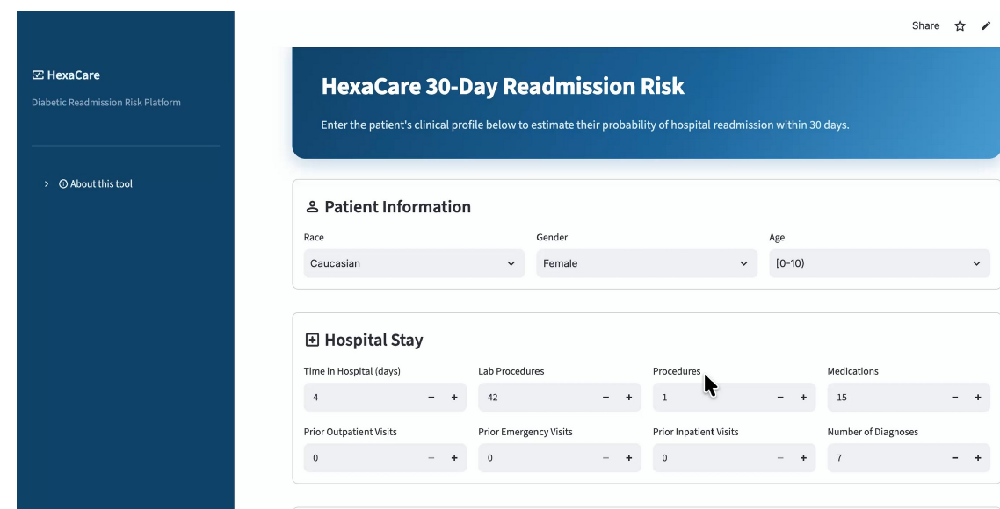
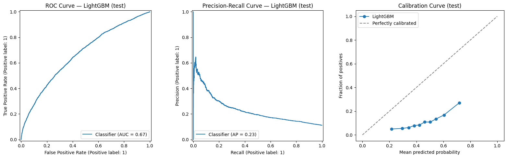

# HexaCare: 30-Day Readmission Risk Prediction for Patients with Diabetes

Capstone project for the **Samsung Innovation Campus AI Course** (in partnership with Misk), completed by Team 13 (HexaCare), September 2026.

The goal is to estimate the risk that a patient with diabetes will be readmitted to hospital within 30 days of discharge, so that high-risk patients can be prioritized for follow-up.

**Live app:** [HexaCare on Streamlit](https://hexacare-readmission-app-7xsuegfrkr3bps9dwpikcb.streamlit.app/)



## Dataset

[Diabetes 130-US Hospitals (1999–2008)](https://archive.ics.uci.edu/dataset/296/diabetes+130-us+hospitals+for+years+1999-2008), UCI Machine Learning Repository.

- 101,766 encounters from 71,518 patients, 50 variables
- Target: readmitted within 30 days (`<30`) vs. not
- Positive class is about 11% of encounters, so the problem is imbalanced

The data is not included in this repository (see How to run).

## Approach

**Cleaning**
- Removed encounters that ended in death or hospice discharge (2,423 rows), leaving 99,343
- Mapped admission type, admission source and discharge disposition codes to their descriptions
- Resolved conflicting gender/race values within the same patient
- Grouped ICD-9 diagnosis codes into clinically meaningful categories
- Dropped near-empty medication columns; final model uses 37 features (8 numeric, 29 categorical)

**Avoiding leakage**
- Train/test split by patient (`GroupShuffleSplit`, 80/20), with zero patient overlap
- 5-fold `StratifiedGroupKFold` for cross-validation
- Scaling and one-hot encoding are fitted inside each fold as part of a scikit-learn `Pipeline`
- Class imbalance handled with class weights, not resampling

**Modeling**
- Compared Logistic Regression, Random Forest, HistGradientBoosting, XGBoost and LightGBM
- Tuned each with `RandomizedSearchCV`, using AUPRC as the selection metric
- Chose the decision threshold by maximizing F2-score on out-of-fold training predictions, since missing a readmission costs more than a false alarm. The test set was only used for the final evaluation.

## Results

Tuned cross-validated AUPRC:

| Model | CV AUPRC |
|---|---:|
| **LightGBM** | **0.2239** |
| XGBoost | 0.2233 |
| HistGradientBoosting | 0.2224 |
| Random Forest | 0.2176 |
| Logistic Regression | 0.2134 |

Final LightGBM model on the held-out test set (19,802 encounters):

| | Default threshold (0.50) | Tuned threshold (0.4074) |
|---|---:|---:|
| Recall | 56.7% | **77.3%** |
| Precision | 17.8% | 14.7% |
| Missed readmissions (FN) | 960 | **503** |
| False alarms (FP) | 5,810 | 9,956 |

ROC-AUC = 0.668, AUPRC = 0.230 (baseline for AUPRC is the positive rate, about 0.11).



## Limitations

- Discrimination is moderate (ROC-AUC ≈ 0.67). Readmission is hard to predict from administrative hospital data alone.
- The lower threshold catches more readmissions but produces many false alarms, so the model suits screening and prioritization, not standalone decisions.
- The calibration curve shows the model overestimates probabilities (a side effect of class weighting). The score should be read as a relative risk ranking, not a calibrated probability.
- The data comes from US hospitals between 1999 and 2008 and would need validation on recent, local data.

## Repository structure

```
hexacare-readmission-prediction/
├── hexacare_readmission.ipynb    # cleaning, preprocessing, modeling, evaluation
├── HexaCare_presentation.pdf     # project presentation
├── user_interface.png
├── evaluation_curves.png
├── requirements.txt
└── README.md
```

## How to run

1. Download the dataset from [UCI](https://archive.ics.uci.edu/dataset/296/diabetes+130-us+hospitals+for+years+1999-2008) and extract `diabetic_data.csv`.

**Option 1: Google Colab (no installation)**
1. Open [Google Colab](https://colab.research.google.com), then File → Upload notebook → select `hexacare_readmission.ipynb`.
2. Upload `diabetic_data.csv` from the Files panel on the left.
3. Run all cells: Runtime → Run all.

**Option 2: Locally**
```bash
git clone https://github.com/saeedabulrahman2026/hexacare-readmission-prediction.git
cd hexacare-readmission-prediction
pip install -r requirements.txt
jupyter notebook hexacare_readmission.ipynb
```
Place `diabetic_data.csv` in the same folder as the notebook, then run all cells.

## Team

| Member | Role |
|---|---|
| Raghad Alotaibi | Data understanding and EDA |
| Saeed Alqahtani | Data cleaning and preprocessing |
| Turki Alonazi | Feature engineering, ML pipeline, deployment |
| Aljawharah Alsubaie | Model development, cross-validation, tuning |
| Danah | Model evaluation and explainability |
| Rana Alsubaie | Streamlit app and visualization |

Thanks to Samsung Innovation Campus, Misk, and our instructors.
